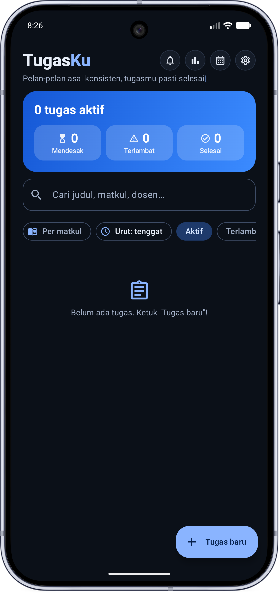
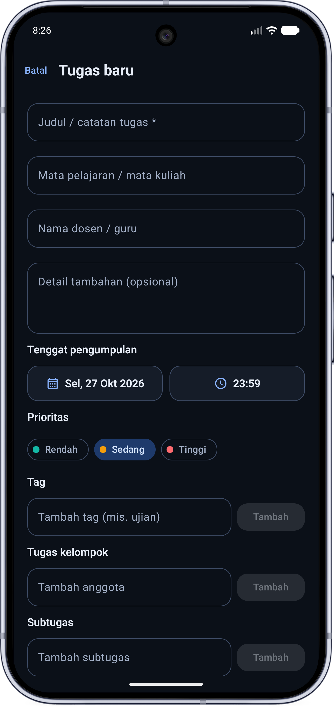
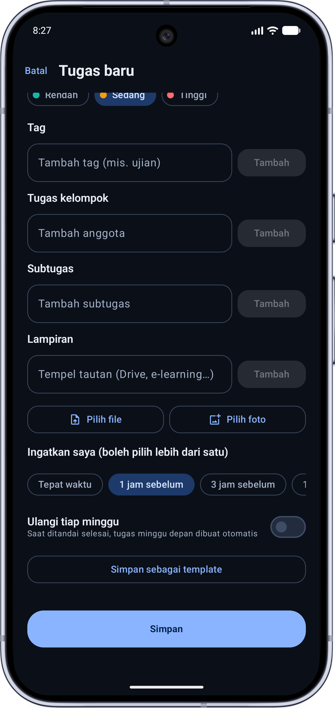
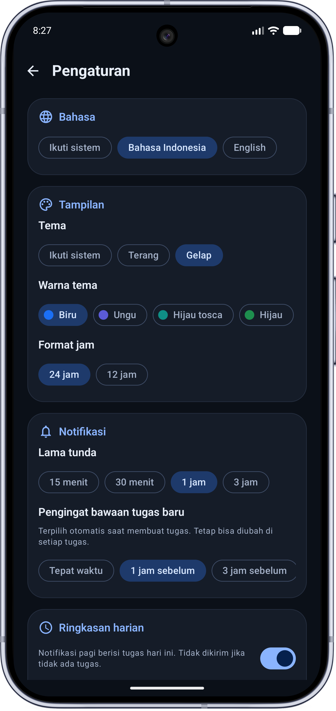
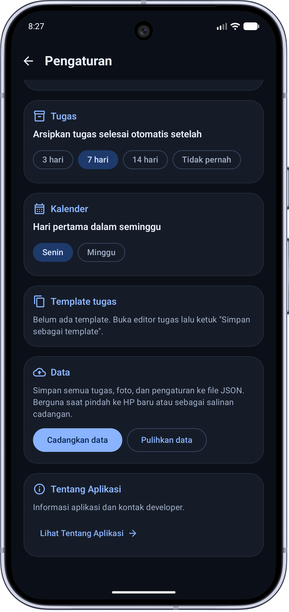
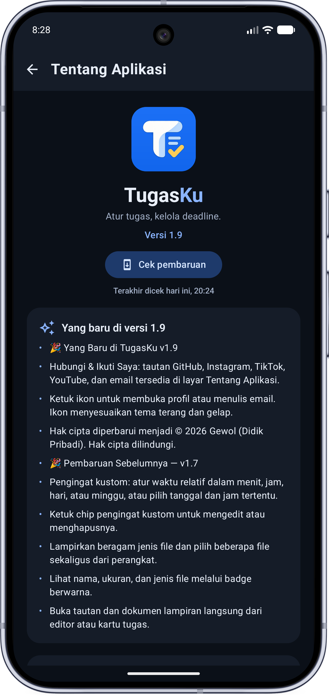
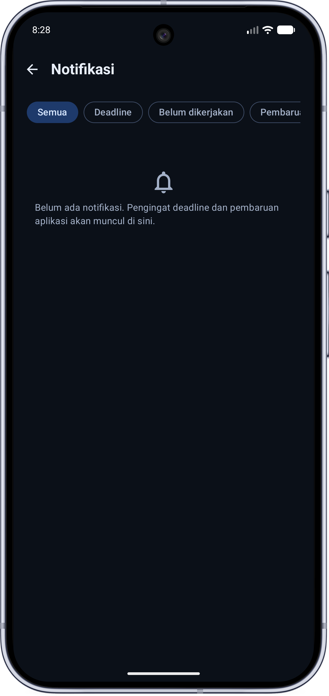
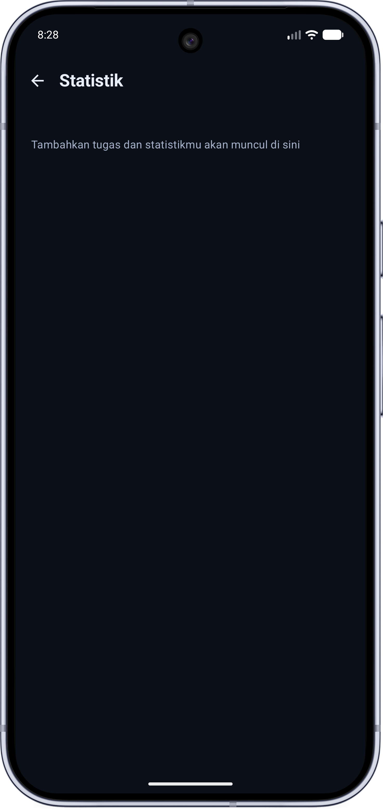
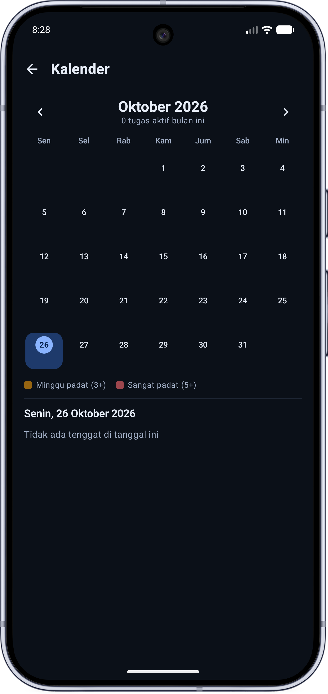
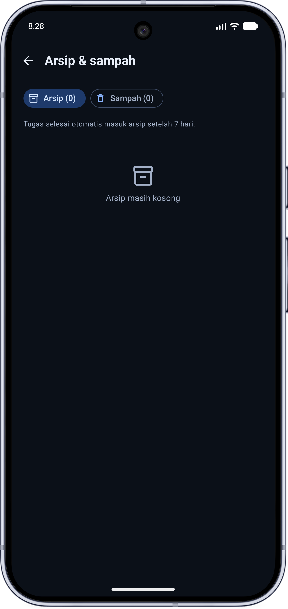

# TugasKu

  <strong>Atur tugas, kelola deadline.</strong> 
  Aplikasi Android sederhana untuk membantu pelajar dan mahasiswa tetap teratur.

  
  
  

## Tampilan aplikasi

Jelajahi tampilan TugasKu. Di ponsel, geser galeri ke samping; di desktop, klik gambar untuk melihat ukuran penuh.

<table>
  <tr>
    <td align="center"> <strong>Beranda</strong> Ringkasan, pencarian, dan filter tugas</td>
    <td align="center"> <strong>Buat tugas</strong> Atur detail, deadline, dan prioritas</td>
    <td align="center"> <strong>Detail tugas</strong> Subtugas, lampiran, dan pengingat</td>
  </tr>
  <tr>
    <td align="center"> <strong>Personalisasi</strong> Tema, bahasa, dan notifikasi</td>
    <td align="center"> <strong>Pengaturan</strong> Kalender, template, dan cadangan data</td>
    <td align="center"> <strong>Tentang aplikasi</strong> Informasi aplikasi dan pembaruan</td>
  </tr>
  <tr>
    <td align="center"> <strong>Notifikasi</strong> Pantau pengingat dan pembaruan</td>
    <td align="center"> <strong>Statistik</strong> Lihat progres tugas</td>
    <td align="center"> <strong>Kalender</strong> Lihat tenggat dalam kalender</td>
  </tr>
  <tr>
    <td align="center"> <strong>Arsip &amp; sampah</strong> Kelola tugas yang selesai atau dihapus</td>
    <td></td><td></td>
  </tr>
</table>

## Fitur

- Mencatat judul tugas, mata pelajaran, nama dosen atau guru, catatan, dan tenggat.
- Melihat ringkasan tugas aktif, mendesak, terlambat, dan selesai.
- Mengatur pengingat bawaan atau membuat pengingat kustom berdasarkan tenggat.
- Memilih tanggal dan jam tertentu untuk pengingat.
- Menjadwalkan ulang pengingat setelah perangkat dimulai ulang.
- Membuat subtugas, mengelola tugas kelompok, dan menyimpan template tugas.
- Melampirkan berbagai jenis file dari perangkat dan memilih beberapa file sekaligus.
- Membuka tautan dan dokumen lampiran langsung dari aplikasi.
- Melihat tugas pada kalender, statistik, arsip, dan sampah.
- Memilih tema terang atau gelap.
- Menyimpan dan mencadangkan data tugas secara lokal di perangkat.
- Menghubungi pengembang melalui email atau mengikuti akun media sosial dari halaman **Tentang Aplikasi**.

## Unduh dan instal

Unduh APK terbaru dari halaman [GitHub Releases](https://github.com/gewolx/TugasKu/releases). Setelah unduhan selesai, buka file APK di perangkat Android dan ikuti petunjuk pemasangan. Jika diminta, izinkan pemasangan aplikasi dari sumber tersebut.

## Persyaratan

- Android 9 (API level 28) atau lebih baru.

## Saran dan laporan bug

Punya saran atau menemukan bug? Kirim email ke [gewol.dev@gmail.com](mailto:gewol.dev@gmail.com). Jika memungkinkan, sertakan penjelasan singkat dan langkah untuk mengulangi masalahnya.

## Pengembang

**Gewol (Didik Pribadi)**

- [GitHub](https://github.com/gewolx)
- [Instagram](https://instagram.com/didikpribadii)
- [TikTok](https://www.tiktok.com/@gewolx)
- [YouTube](https://www.youtube.com/@gewolx)

## Teknologi

- Kotlin
- Jetpack Compose

