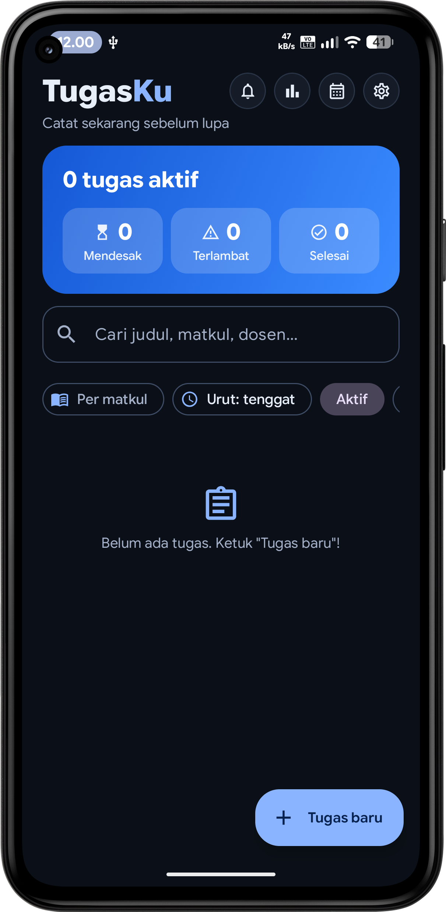
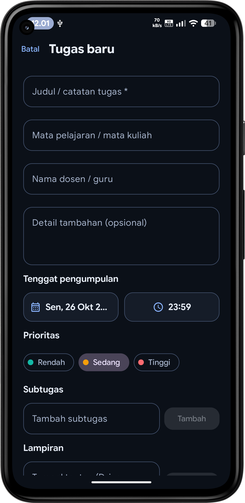
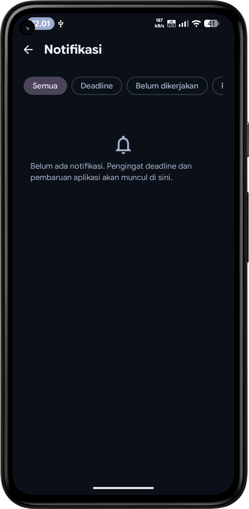
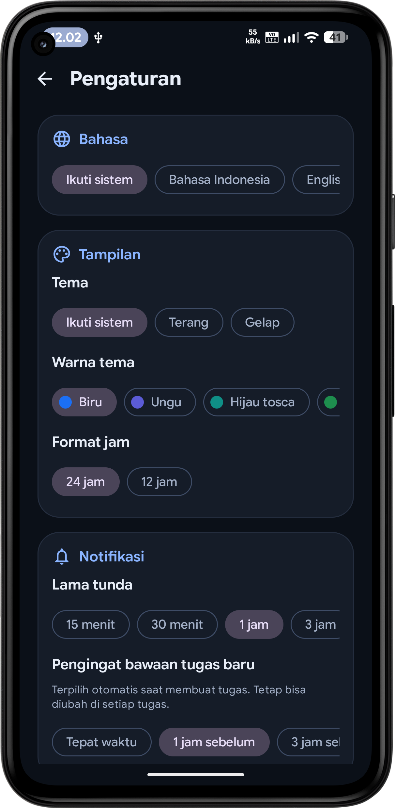
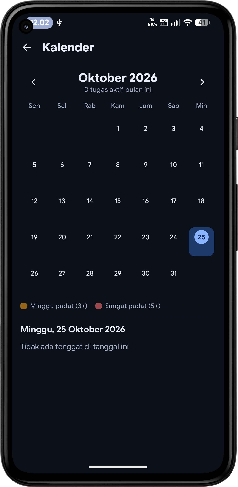
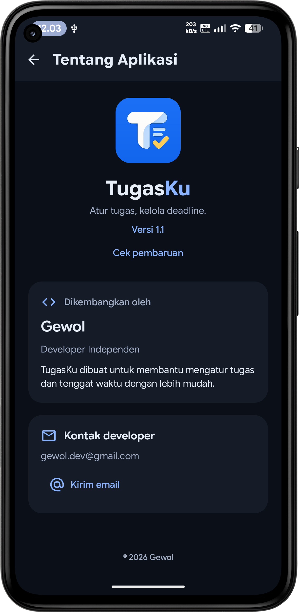

# TugasKu

**TugasKu** adalah aplikasi Android untuk membantu pelajar dan mahasiswa mencatat tugas, memantau tenggat, dan menerima pengingat tepat waktu.

## Tangkapan layar

  
  
  
  
  
  

## Fitur

- Mencatat tugas, mata pelajaran, nama dosen atau guru, dan tenggat
- Mengatur notifikasi pengingat sebelum tenggat
- Menjadwalkan ulang pengingat setelah perangkat dimulai ulang
- Melihat ringkasan tugas aktif, mendesak, terlambat, dan selesai
- Memilih tema terang atau gelap
- Menyimpan data secara lokal di perangkat

## Unduh dan instal

Unduh APK terbaru dari halaman [Releases](https://github.com/gewolx/TugasKu/releases). Setelah unduhan selesai, buka file APK di perangkat Android dan ikuti petunjuk pemasangan. Jika diminta, izinkan pemasangan aplikasi dari sumber tersebut.

## Persyaratan

- Android 9 (API level 28) atau lebih baru

## Saran dan laporan bug

Punya saran atau menemukan bug? Kirim email ke [gewol.dev@gmail.com](mailto:gewol.dev@gmail.com). Jika memungkinkan, sertakan penjelasan singkat dan langkah-langkah untuk mengulangi masalahnya.

## Teknologi

- Kotlin
- Jetpack Compose
